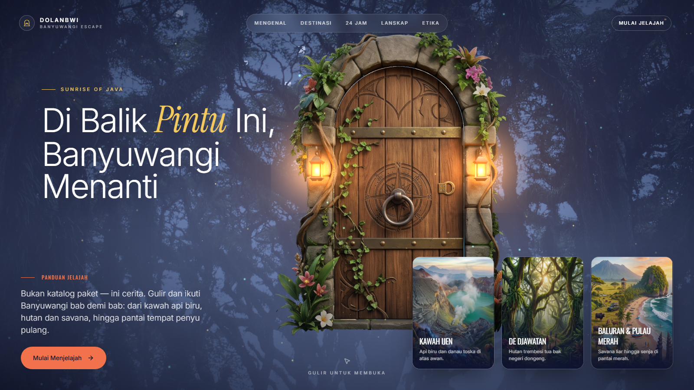

<div align="center">

# DolanBwi — Banyuwangi Escape

**A cinematic scroll-story travel guide to Banyuwangi, East Java.**

Step through a 3D door and travel chapter by chapter: from Ijen's blue fire,
through jungle and savanna, to the beach where turtles come home.

[**Live Demo**](https://dolanbwi-website.vercel.app) · [Report a Bug](https://github.com/x4zu/DolanBwi-Website/issues) · [Author Portfolio](https://new-porto-reivan.vercel.app)



</div>

---

## Features

- **3D door hero.** A React Three Fiber scene. Scrolling opens the door and flies the camera through it.
- **Scroll-driven storytelling.** Pinned sections, word-by-word text reveals, a photo window that grows to full screen, and animated counters.
- **Nine destination chapters.** Kawah Ijen, De Djawatan, Baluran, Pulau Merah, Alas Purwo and more, each with facts and a photo gallery.
- **"24 Hours in Banyuwangi".** A horizontal pinned timeline with parallax photos.
- **Landscape stack.** Sticky cards that stack up as you scroll.
- **Travel etiquette epilogue.** The closing photo opens to full screen.
- **Smooth scrolling** with Lenis, synced to GSAP ScrollTrigger.
- **Sharp photos everywhere.** AVIF/WebP, quality 90 and widths up to 3200px for retina and 1440p+ screens.
- **Responsive** from 360px phones to ultrawide monitors.

## Tech Stack

| Area | Tools |
|---|---|
| Framework | [Next.js 16](https://nextjs.org) (App Router), React 19, TypeScript |
| Styling | Tailwind CSS v4, shadcn/ui primitives |
| 3D | three.js, @react-three/fiber, @react-three/drei |
| Animation | GSAP + ScrollTrigger, Framer Motion, Lenis |
| Hosting | Vercel |

## Getting Started

### Requirements

- Node.js **24** or newer (see `.nvmrc`)
- npm 10 or newer

### Install and run

```bash
git clone https://github.com/x4zu/DolanBwi-Website.git
cd DolanBwi-Website
npm install
npm run dev
```

Open <http://localhost:3000>.

### Scripts

| Command | What it does |
|---|---|
| `npm run dev` | Start the dev server with hot reload |
| `npm run build` | Make a production build |
| `npm run start` | Serve the production build |
| `npm run lint` | Run ESLint |
| `npm run typecheck` | Run the TypeScript compiler without emitting files |
| `npm run check` | Run lint, typecheck and build in one go |

## Project Structure

```
src/
├── app/
│   ├── layout.tsx            # Fonts, metadata, smooth-scroll provider
│   ├── page.tsx              # Page order: hero, chapters, footer
│   └── globals.css           # Design tokens (colors, fonts) + Tailwind
├── components/
│   ├── hero/                 # 3D door hero (DoorHero + DoorScene)
│   ├── Prologue.tsx          # 01 · Getting to know Banyuwangi
│   ├── ExploreBanyuwangi.tsx # 02 · Nine destinations
│   ├── DayJourney.tsx        # 03 · 24 hours timeline
│   ├── LandscapeStack.tsx    # 04 · Four landscapes
│   ├── Epilogue.tsx          # 05 · Travel etiquette
│   ├── SiteHeader.tsx
│   ├── SiteFooter.tsx
│   ├── icons.tsx
│   └── providers/SmoothScroll.tsx
├── data/
│   ├── site.ts               # ALL page content lives here
│   └── credits.json          # Photo credits (Wikimedia Commons)
├── lib/utils.ts
└── types/index.ts            # Content types
public/images/
├── bwi/      # Destination photos
├── cards/    # Hero highlight cards
├── door/     # Door textures + geometry
└── zones/    # Landscape illustrations
```

## Customization Guide

### 1. Edit the content

All text lives in **`src/data/site.ts`**. The components only render it.

| Export | Controls |
|---|---|
| `BRAND` | Site name and tagline |
| `HERO_CARDS` | The three highlight cards on the hero |
| `CHAPTERS` | Destination chapters: name, story, facts, hero photo, gallery |
| `JOURNEY` | Stops on the 24-hour timeline |
| `LANDSCAPES` | Cards in the landscape stack |
| `PRINCIPLES` | Travel etiquette points in the epilogue |

The shapes of these objects are typed in `src/types/index.ts`. TypeScript shows an error if you miss a field.

### 2. Change or add photos

1. Put the image in `public/images/bwi/` as `<slug>.jpg`.
2. Use at least **2560px** width for full-screen sections. Smaller photos look soft on large screens.
3. Point to it from `site.ts` by slug, for example `img("kawah-ijen")`.
4. Add the photo's author and license to `src/data/credits.json`. The footer lists it automatically.

### 3. Change colors and fonts

Edit the design tokens in `src/app/globals.css` (the `@theme` block). Fonts load in `src/app/layout.tsx` through `next/font`.

### 4. Change the page order

Reorder or remove sections in `src/app/page.tsx`. If you add or remove a chapter, also update the anchor links in `SiteHeader.tsx` and `SiteFooter.tsx`.

### 5. Update SEO

Edit `title` and `description` in the `metadata` export of `src/app/layout.tsx`. Add an `openGraph` field there if you want social share previews.

## Deploying

### Vercel (recommended)

1. Push the repo to GitHub.
2. Import it at [vercel.com/new](https://vercel.com/new).
3. Deploy. `vercel.json` already sets the framework to Next.js. No environment variables are needed.

Or use the CLI:

```bash
npm i -g vercel
vercel --prod
```

### Self-hosting

`next.config.ts` uses `output: "standalone"`:

```bash
npm run build
node .next/standalone/server.js
```

Copy `public/` and `.next/static/` next to the standalone server, as the [Next.js docs](https://nextjs.org/docs/app/api-reference/config/next-config-js/output) describe.

## Credits

- Destination photos come from **Wikimedia Commons** under their own licenses. The full list is in `src/data/credits.json` and in the site footer.
- The door illustration and landscape zone art are DolanBwi assets.

## License

The code is released under the [MIT License](LICENSE). Photos keep their original licenses (see Credits).

---

<div align="center">

Made by **[Reivan Elsyafir Pratama](https://new-porto-reivan.vercel.app)**

</div>
